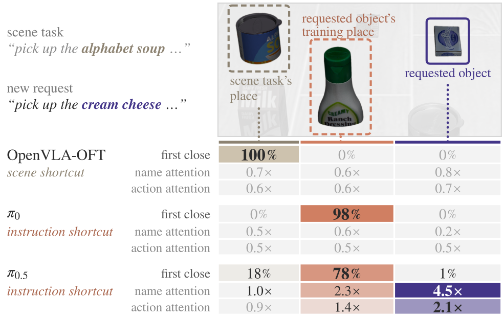
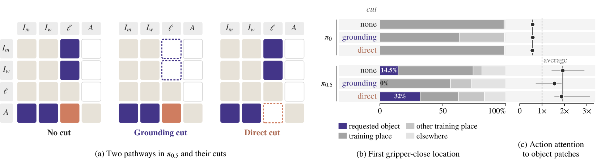
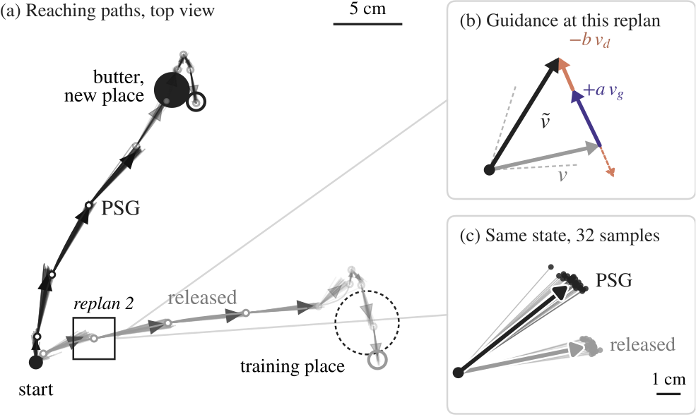

<div align="center">

<h1>Seeing Is Not Reaching</h1>

<h3>Instruction Shortcuts Override Visual Grounding in Vision-Language-Action Models</h3>

**Qing Zhang**<sup>1</sup> &nbsp;·&nbsp; **Xuesong Li**<sup>1,2</sup> &nbsp;·&nbsp; **Zhaoyuan Yang**<sup>3</sup> &nbsp;·&nbsp; **Changlin Song**<sup>1</sup> &nbsp;·&nbsp; **Xinyu Tian**<sup>1</sup> &nbsp;·&nbsp; **Jing Zhang**<sup>1</sup>

<sup>1</sup>Australian National University &emsp; <sup>2</sup>CSIRO &emsp; <sup>3</sup>GE Research


<a href="https://github.com/QZhang2111/psg/actions/workflows/tests.yml"></a>
<a href="LICENSE"></a>


[**The finding**](#the-finding) &nbsp;|&nbsp; [**Results**](#results) &nbsp;|&nbsp; [**PSG**](#psg-pathway-separated-guidance) &nbsp;|&nbsp; [**Installation**](#installation) &nbsp;|&nbsp; [**Quick start**](#quick-start) &nbsp;|&nbsp; [**Reproduce the tables**](#reproduce-the-tables)

</div>

<p align="center">
  
</p>

<p align="center"><em>Same scene, new request. OpenVLA-OFT follows the scene; π<sub>0</sub> and π<sub>0.5</sub> follow the instruction to the<br>requested object's training place. π<sub>0.5</sub> does so although its attention is on the requested object.</em></p>

Vision-language-action models (VLAs) are expected to inherit visual grounding from vision-language models, yet
they often reach for an object's training location after it has been moved. The paper asks why, and answers
with **Pathway-Separated Guidance (PSG)**: an inference-time method for the released π<sub>0.5</sub> policy
that amplifies grounding and suppresses the shortcut, without training and without external target locations.

This repository holds the code and the results behind the paper's main text: the method, PSG; the one
evaluation that produces Tables 1-3; and the paper's own instrument, the pathway cuts, with the oracle push. The
figures' measurements are kept as results and records; no script here draws a figure. The code of the
appendix's experiments follows.

## The finding

- **Two shortcuts.** Across six VLAs, the arm either follows the scene's original task despite a new
  instruction (the *scene shortcut*), or the instruction retrieves the requested object's training location
  (the *instruction shortcut*).
- **Seeing is not reaching.** In π<sub>0.5</sub>, the instruction shortcut persists even though the attention
  of the object's name follows the moved target.
- **Overridden, not unused.** The instruction reaches the action through two pathways: through the image
  tokens (grounding), or read directly by the action tokens. Over 200 episodes with a moved target, masking
  the grounding pathway takes π<sub>0.5</sub>'s reaches from 29 to 0, and masking the direct pathway raises
  them from 29 to 64. Grounding already guides the action; the shortcut, acting through the direct pathway,
  overrides it.

<p align="center">
  
</p>

<p align="center"><em>(a) The two pathways and their cuts. (b) Where the gripper first closes under each cut. (c) Action-token attention to the moved object.</em></p>

## Results

π<sub>0.5</sub> with and without PSG, same checkpoint, one setting everywhere (a = 5, b = 1). All numbers in %.

<div align="center">
<table>
  <thead>
    <tr>
      <th rowspan="2" align="left">Method</th>
      <th>LIBERO</th>
      <th colspan="2">LIBERO-PRO Position<br><sub>Object</sub></th>
      <th colspan="2">LIBERO-PRO Position<br><sub>average of three suites</sub></th>
      <th colspan="2">LIBERO-PRO Task<br><sub>average</sub></th>
      <th colspan="2">LIBERO-CF<br><sub>average</sub></th>
    </tr>
    <tr>
      <th><sub>Succ.</sub></th>
      <th><sub>Reach</sub></th><th><sub>Succ.</sub></th>
      <th><sub>Reach</sub></th><th><sub>Succ.</sub></th>
      <th><sub>Reach</sub></th><th><sub>Succ.</sub></th>
      <th><sub>Reach</sub></th><th><sub>Succ.</sub></th>
    </tr>
  </thead>
  <tbody>
    <tr>
      <td align="left">π<sub>0.5</sub></td>
      <td align="center">96.7</td>
      <td align="center">22.0</td><td align="center">16.6</td>
      <td align="center">62.6</td><td align="center">31.7</td>
      <td align="center">44.6</td><td align="center">29.6</td>
      <td align="center">17.7</td><td align="center">12.3</td>
    </tr>
    <tr>
      <td align="left"><b>π<sub>0.5</sub> + PSG</b></td>
      <td align="center">95.2</td>
      <td align="center"><b>52.6</b></td><td align="center"><b>40.8</b></td>
      <td align="center"><b>76.5</b></td><td align="center"><b>44.7</b></td>
      <td align="center"><b>50.4</b></td><td align="center"><b>34.3</b></td>
      <td align="center"><b>30.9</b></td><td align="center"><b>18.2</b></td>
    </tr>
  </tbody>
</table>
</div>

*Reach*: the share of episodes in which the gripper first closes on the requested object. *Succ.*: the
benchmark's own task success. These are selected columns of the paper's Tables 1 and 3; the full tables, with
eight more policies and methods, are printed from this repository's results by one command (any Python >= 3.8,
no card):

```
python -m evaluation.tables.render            # prints Tables 1-3
python -m evaluation.tables.render --check    # compares all 222 numbers with the tables as printed
```

## PSG: Pathway-Separated Guidance

PSG is an inference-time method on the released π0.5 policy. At every Euler step of sampling it measures, with
two attention cuts, what the instruction contributes to the action through the image (grounding) and what it
contributes by being read directly by the action tokens; it amplifies the first and removes the second. No
parameter of the checkpoint changes.

```
v_g = v - v[I_m -/-> N]          what grounding contributes: v without the main-camera image tokens reading the name
v_d = v - v[A -/-> l]            what the direct pathway contributes: v without the action tokens reading the instruction
v~  = v + a * v_g - b * v_d      a = 5, b = 1; on the six motion dimensions, the gripper dimension keeps v
```

That is the method, and it is [`psg/sampler.py`](psg/sampler.py) (its opening text states it in full). Which instruction tokens are "the name" is [`psg/name_rule.py`](psg/name_rule.py): every noun phrase
of the instruction, from the text alone.

<p align="center">
  
</p>

<p align="center"><em>(a) One episode, seen from above: the released policy returns to the training place, PSG reaches the moved butter.<br>(b) The guidance at the highlighted replan. (c) 32 samples at the same state, without and with PSG.</em></p>

## Installation

openpi at the commit the paper used, with its own environment ([`uv`](https://docs.astral.sh/uv/)), then this
repository beside it and `psg` installed into that environment:

```
git clone --recurse-submodules https://github.com/Physical-Intelligence/openpi
git -C openpi checkout 15a9616a00943ada6c20a0f158e3adb39df2ccac && git -C openpi submodule update --init --recursive
(cd openpi && GIT_LFS_SKIP_SMUDGE=1 uv sync)
git clone https://github.com/QZhang2111/psg
uv pip install --python openpi/.venv/bin/python -e psg
```

`psg` declares no dependency: openpi's environment already has JAX and everything else it uses. The Quick start
needs one card (it was run on one with 24 GB); openpi downloads the 11.58 GB checkpoint on first use, into
`~/.cache/openpi` or `$OPENPI_DATA_HOME`.

## Quick start

PSG on openpi's released π0.5-LIBERO policy, one chunk of actions. From the directory that holds the two
checkouts:

```
openpi/.venv/bin/python psg/examples/quick_start.py
```

[`examples/quick_start.py`](examples/quick_start.py) is this:

```python
import numpy as np
from openpi.policies import policy_config
from openpi.shared import download
from openpi.training import config as openpi_config

from psg.policy import PsgPolicy

config = openpi_config.get_config("pi05_libero")
checkpoint = download.maybe_download("gs://openpi-assets/checkpoints/pi05_libero")
policy = PsgPolicy(policy_config.create_trained_policy(config, checkpoint), config)  # a = 5, b = 1

request = {
    "observation/image": np.zeros((224, 224, 3), np.uint8),  # main camera
    "observation/wrist_image": np.zeros((224, 224, 3), np.uint8),
    "observation/state": np.zeros(8),  # end-effector position, axis-angle orientation, gripper joints
    "prompt": "put the bowl on the plate",
}
chunk = policy.infer(request)["actions"]
print(chunk.shape)  # (10, 7)
```

The first call compiles the sampler; on one 24 GB card the whole example, with the model load, takes about two
minutes.

`PsgPolicy` ([`psg/policy.py`](psg/policy.py)) wraps the openpi policy: the same transforms around PSG's
sampler, the name taken from the prompt. The evaluation's row `pi05_psg` runs through the same class.

## Reproduce the tables

```
python -m evaluation.run --block PP-O --row pi05_psg
```

runs π0.5 + PSG on one evaluation block (here LIBERO-PRO Position, Object: 10 tasks × 50 start states) and
writes the settings it actually used and one line per episode. The same line runs every other row of the
paper's tables; only the two names change. What a machine needs first:
[`evaluation/README.md`](evaluation/README.md), section 2; for PSG alone, two environments and one checkpoint.

## What is where

```
psg/           the method: sampler.py, name_rule.py, and policy.py, which puts it on an openpi policy
examples/      quick_start.py, the Quick start as a file
evaluation/    the one evaluation behind the tables: run.py, the test sets (blocks/), the rows (rows/),
               how each environment is built (environments/), the tables' command (tables/)
instruments/   the pathway cuts (Sec. 3.3) and the oracle push
results/       one config record and one episode table per unit
records/       what the paper uses and was not re-run here
assets/        the three pictures of this page
tests/
```

- [`PAPER.md`](PAPER.md): every table and figure of the paper: where its results lie, what was made here and
  what was recorded.
- [`evaluation/README.md`](evaluation/README.md): the evaluation: the command, setting up a machine, the blocks
  and rows, each table by hand, the tests.
- [`instruments/README.md`](instruments/README.md): the two instruments by hand.

Every baseline's environment is built from its authors' release, and so is openpi's: the `openpi` environment
is [upstream openpi](https://github.com/Physical-Intelligence/openpi) at commit `15a9616`, declared in
[`evaluation/environments/openpi.json`](evaluation/environments/openpi.json) like the other environments. No
copy of openpi's source is in this repository, and nothing here changes it: both of PSG's cuts are attention
masks passed to openpi's own transformer. The units in `results/` were run on a copy of that source with
changes in six files (next section).

## The results, and which code made them

`results/` holds 129 units and 72,640 episodes, each unit as the config record and the episode table its run
wrote: the 104 units the tables print, ten more on `OS-O` that no table prints, SmolVLA's four LIBERO units
with 2,000 episodes (Table 1 cites its authors' average instead), three instrument units with 400 episodes,
and the eight arms of the pathway cuts with 2,000 episodes. One noise seed in every unit.
Nothing in `results/` is typed, and nobody edits a record.

<details>
<summary><b>Under which package name the units ran, and what was compared with this repository</b></summary>
<br>

The units were run by this code under its earlier package name, `pi05lab`, in a repository that also held a
copy of openpi's source: openpi at `15a9616` with reading annotations in comments and an intervention hook
that no row used, six files changed against upstream. They were not run on the pinned release itself. Their
config records name that package and that source ("this repository, src/openpi (… at 15a9616 with reading
annotations)") and are kept as they were written. Nine of the records, the row `turbovla`'s, name a local
directory of the machine that ran them in the paths of the row's two encoders; the revisions at the end of
those paths are what identifies the files.

What was compared, on one card with the rows' deterministic settings: with the `openpi`
environment built from upstream at the pinned commit, 51 whole episodes run from this repository on `PP-O`
were identical, in every array both traces hold, to episodes the same
card had recorded from the earlier repository. They are 4 of released π0.5, 3 of PSG, 4 of PSG at a = 5,
b = 0, 12 of the grounding cut, 4 of π0 (against the earlier episodes of π0's nothing-cut arm), and 4 short
episodes of each of the six cut rows. That is a comparison of these episodes, not a second run of a table.

</details>

## Tests

From the repository's root:

```
python -m pytest tests/                        # any Python >= 3.8 with NumPy and pytest; no card, no weights
PSG_HOST_TESTS=1 python -m pytest tests/   # with the openpi environment's Python: also the samplers on small random models
CUDA_VISIBLE_DEVICES= JAX_PLATFORMS=cpu PSG_HOST_TESTS=1 python -m pytest tests/   # the same, held to the CPU: no card
```

More in [`evaluation/README.md`](evaluation/README.md), section 7.

## Credit

| | |
|---|---|
| openpi (Physical Intelligence): the model code | Apache-2.0; it also ships Gemma's terms of use (`LICENSE_GEMMA.txt` in its repository); address and revision in `evaluation/environments/openpi.json` |
| the π0, π0-FAST and π0.5 LIBERO checkpoints (Physical Intelligence) | released with openpi; their addresses are in the rows' `row.json`, where the licence stands as "not stated" |
| LIBERO, LIBERO-PRO, LIBERO-Plus, LIBERO-CF | the benchmarks; address, revision and licence of each are in every block's `block.json` (`benchmark`) |
| OpenVLA-OFT, SmolVLA (lerobot), TurboVLA, CAG, RSS, APT | run from their authors' releases; address and revision of the code are in `evaluation/environments/<name>.json`, of the weights in `evaluation/rows/<row>/row.json` |

## Licence

Copyright 2026 The PSG authors. The files of this repository are released under the Apache License, Version 2.0
([`LICENSE`](LICENSE)). The projects named under Credit are not part of it and keep their own terms.
